# Medical Chatbot

結合**皮膚影像辨識**與**自然語言處理**的中文醫療聊天機器人。  
使用者在網頁上傳皮膚病變影像，系統先辨識出疾病類別，使用者接著可以用中文自由提問(例如「需要看醫生嗎？」「會傳染嗎？」「怎麼治療？」)，系統會根據疾病與問題生成自然的中文回答，而不是套用固定的回覆範本。

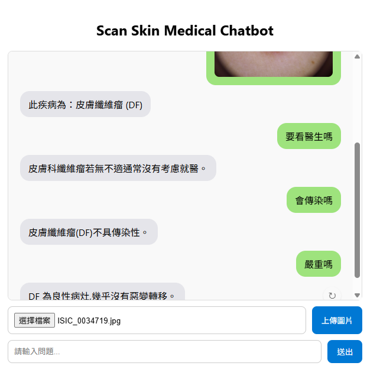

- **語言**：Python
- **影像辨識**：PyTorch、timm(Swin Transformer)、FAT-Net
- **自然語言處理**：Hugging Face Transformers、BERT(`bert-base-chinese`)、mT5(`google/mt5-small`)
- **網頁**：Flask、HTML/CSS/JavaScript

> 本系統為教育與輔助用途，回答內容不能取代專業醫師的診斷。

## 系統架構

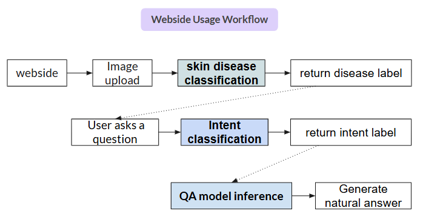

1. **影像辨識**：使用者上傳皮膚影像後，由Swin Transformer分類模型判斷屬於7種皮膚病變中的哪一種：
   惡性黑色素瘤(MEL)、黑色素痣(NV)、基底細胞癌(BCC)、脂漏性角化病(BKL)、光化性角化病(AKIEC)、皮膚纖維瘤(DF)、血管病變(VASC)。
2. **意圖分類**：以`bert-base-chinese`微調的分類模型，判斷使用者問題屬於5種意圖之一：介紹(intro)、是否需要就醫(need_doctor)、治療方式(treatment)、是否傳染(contagious)、風險(risk)。
3. **回答生成**：將「疾病中文名(英文縮寫)相關問題：使用者問題」輸入微調後的mT5模型，生成自然語言回答。

## 功能

| 功能 | 說明 |
|---|---|
| 上傳影像辨識 | 上傳皮膚影像後顯示辨識出的疾病名稱 |
| 中文自由問答 | 針對辨識結果用中文提問，系統依疾病與問題意圖生成回答 |
| 重新生成回答 | 採用取樣式生成，同一問題可以重新產生不同說法的回答 |
| 防呆提示 | 尚未上傳影像就提問時，提醒使用者先上傳圖片 |

## 模型與成果

### 意圖分類(BERT)

| 項目 | 內容 |
|---|---|
| 模型 | `bert-base-chinese`(12層Transformer encoder，hidden size 768) |
| 資料集 | 自建190筆中文問句，5種意圖各38筆([`intent_dataset.json`](intent_classifier/intent_dataset.json)) |
| 訓練設定 | batch size 16、10 epochs、learning rate 3e-5、warmup 0.2、weight decay 0.05、EarlyStopping(patience 2) |
| 結果 | Accuracy 0.9497、Precision 0.9544、Recall 0.9474、F1 0.9473 |

| 資料集範例 | Loss | 評估指標 |
|---|---|---|
| 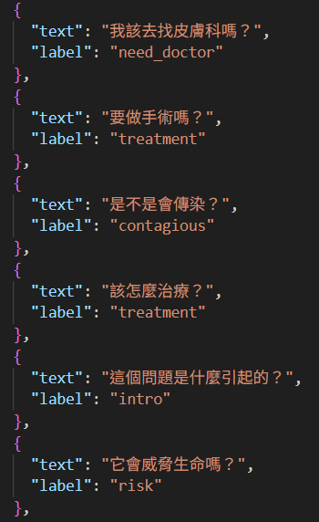 | 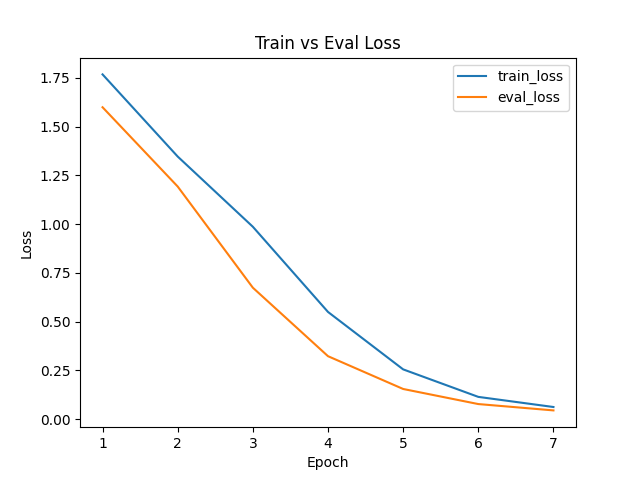 | 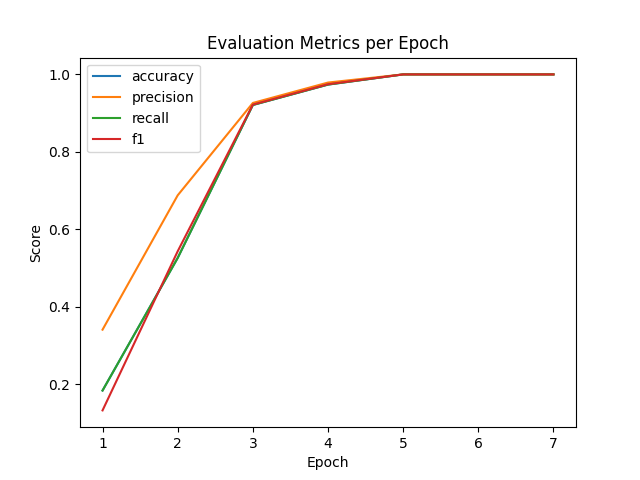 |

### 回答生成(mT5)

| 項目 | 內容 |
|---|---|
| 模型 | `google/mt5-small`(約300M參數) |
| 資料集 | 344筆「疾病+意圖→回答」結構化資料，每筆自動生成5種自然語言問法，擴充為1,720筆 |
| 訓練設定 | Seq2Seq fine-tuning，batch size 8、20 epochs、learning rate 2e-4 |
| 解碼策略 | top-k/top-p取樣、repetition penalty、no-repeat n-gram，避免回答重複或模板化 |
| 結果 | Perplexity 3.55、ROUGE-L 43.00、BLEU 9.41 |

| 問答模型架構 | 訓練Loss |
|---|---|
| 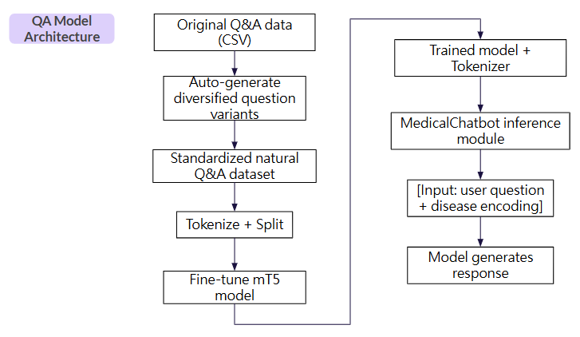 | 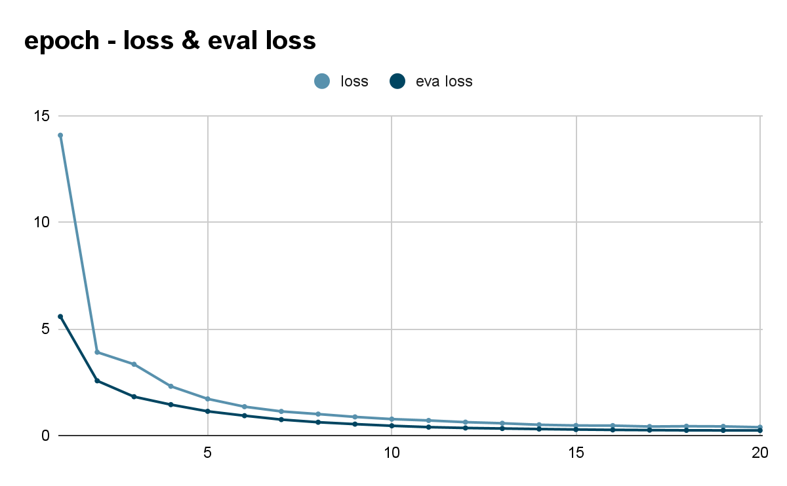 |

### 皮膚病變辨識

| MEL | NV | BCC | BKL |
|---|---|---|---|
| 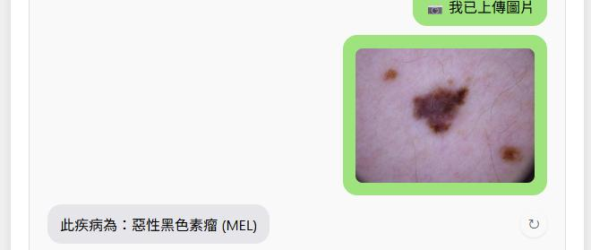 | 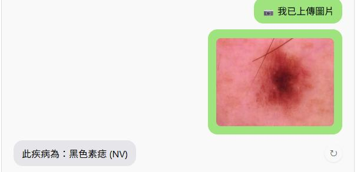 | 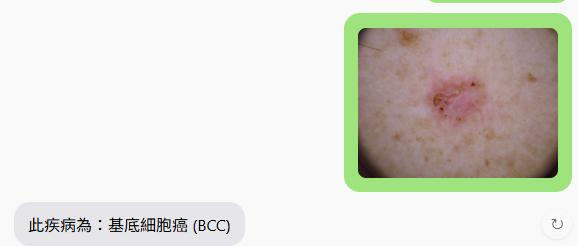 | 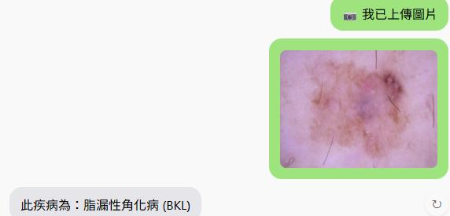 |

| AKIEC | DF | VASC |
|---|---|---|
| 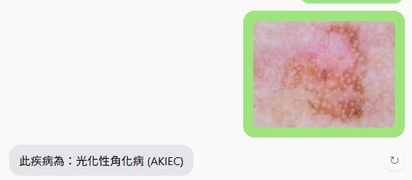 | 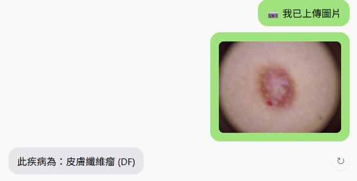 | 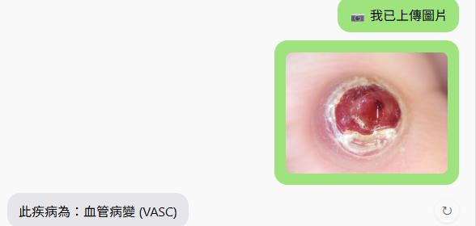 |

## 對話範例

| 皮膚纖維瘤：會傳染嗎 | 皮膚纖維瘤：要看醫生嗎 |
|---|---|
| 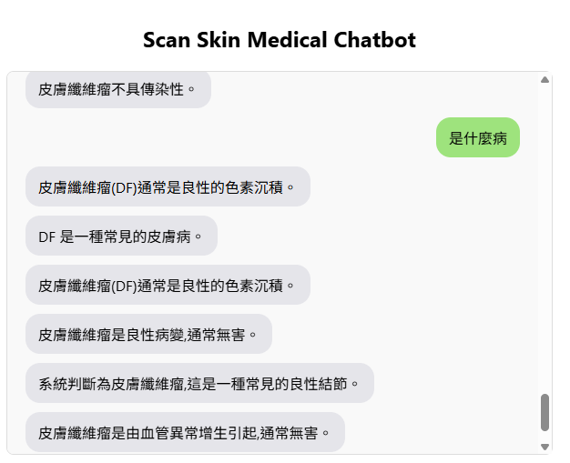 | 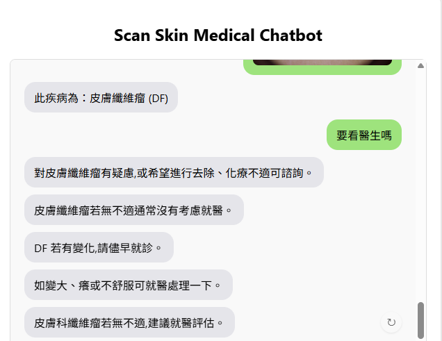 |

| 血管病變：會傳染嗎 | 惡性黑色素瘤：怎麼治療 | 血管病變：嚴重嗎 |
|---|---|---|
| 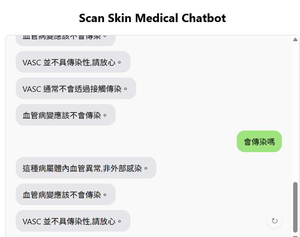 | 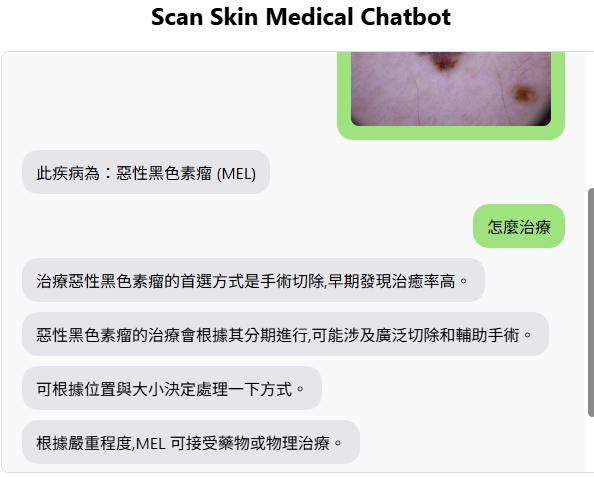 | 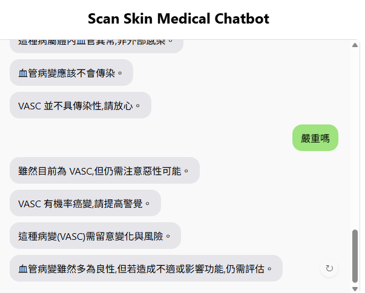 |

## 開發過程中的調整

- **資料不足、語氣不自然**：手動補充資料，並為每筆回答產生多種語氣與問法。
- **回答不連貫或缺乏上下文**：在訓練輸入中加入疾病資訊，並調整解碼策略。
- **回答模板化**：每筆資料搭配多種問句，並調整訓練參數。
- **系統演進**：第一版以BERT判斷意圖後，從「疾病+意圖」對應的回答範本中挑選回覆([`intent_chatbot_demo.py`](intent_classifier/intent_chatbot_demo.py))；最終版改以mT5生成回答，並把意圖資訊融入問答資料的訓練中，讓回答更自然多樣。

## 專案結構

```
Medical-Chatbot/
├── app.py                         Flask後端：影像辨識、上傳與聊天API
├── medical_chatbot_module.py      mT5問答模型推論(MedicalChatbot類別)
├── train_medical_chatbot.py       問答資料擴充與mT5訓練
├── evaluate_metrics.py            問答模型評估(Perplexity、ROUGE、BLEU)
├── t5_intent_disease_qa_dataset_large.csv   原始問答資料(疾病+意圖→回答)
├── natural_medical_qa.csv         擴充後的自然語言問答資料
├── templates/index.html           聊天網頁介面
├── intent_classifier/             BERT意圖分類
│   ├── intent_dataset.json        意圖分類資料集
│   ├── train_intent_classifier.py 訓練意圖分類模型
│   ├── train_and_plot.py          訓練並輸出Loss與評估指標圖
│   ├── evaluate_intent.py         評估意圖分類模型
│   ├── intent_chatbot_demo.py     意圖分類+回答範本的對話示範
│   └── response_templates.csv     回答範本
├── requirements.txt
└── docs/images/                   架構圖、訓練曲線與執行畫面
```

## 安裝與執行

1. 安裝套件：

   ```bash
   pip install -r requirements.txt
   ```

2. 訓練模型(模型權重檔案較大，未收錄在此repo中)：

   ```bash
   python train_medical_chatbot.py                       # 產生 medical_chatbot_final/

   cd intent_classifier
   python train_intent_classifier.py                     # 產生 intent_classifier/intent_model/
   ```

3. 準備皮膚影像辨識模型，放在`skin_model/`：
   - `resnext50_32x4d_fold2_best_epoch8.pth`：Swin Transformer分類模型
   - `checkpoint1017_last.pth.tar`：FAT-Net分割模型

4. 啟動網頁：

   ```bash
   python app.py      # http://127.0.0.1:5000
   ```

5. 只想測試意圖分類，可在`intent_classifier/`執行`python intent_chatbot_demo.py`，在終端機輸入疾病代碼與問題，查看預測意圖與回覆。

## 說明

- 模型權重(mT5約1.2GB、BERT約400MB、影像模型各約350MB)超過GitHub檔案大小限制，因此沒有收錄，請依上方步驟訓練或自行準備。
- 皮膚病變影像辨識模型沿用自先前的皮膚病變辨識專題，訓練資料主要來自公開資料集[HAM10000](https://doi.org/10.7910/DVN/DBW86T)。

## 開發分工

本專題為2人團隊開發，我負責的部分：

- **BERT意圖分類模型**：建立190筆意圖資料集、模型訓練、評估與視覺化，以及意圖+回答範本的第一版對話系統
- **網頁介面**與Flask後端API
- **整合皮膚影像辨識模型**，串接上傳影像、辨識結果與聊天流程
- 嘗試以mT5生成回答的初版實作
- 負責系統Demo，並與組員共同完成報告

mT5回答生成模型的訓練，以及將意圖資訊融入問答模型，由另一位組員完成。
